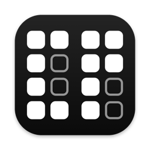
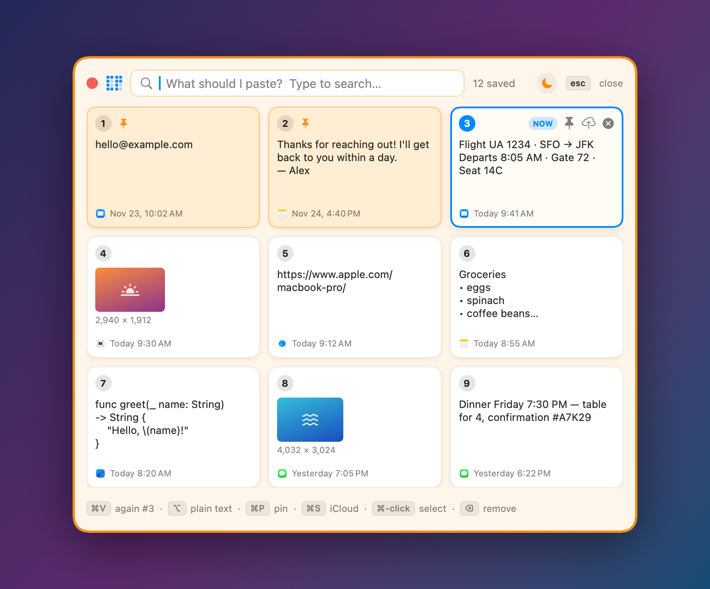
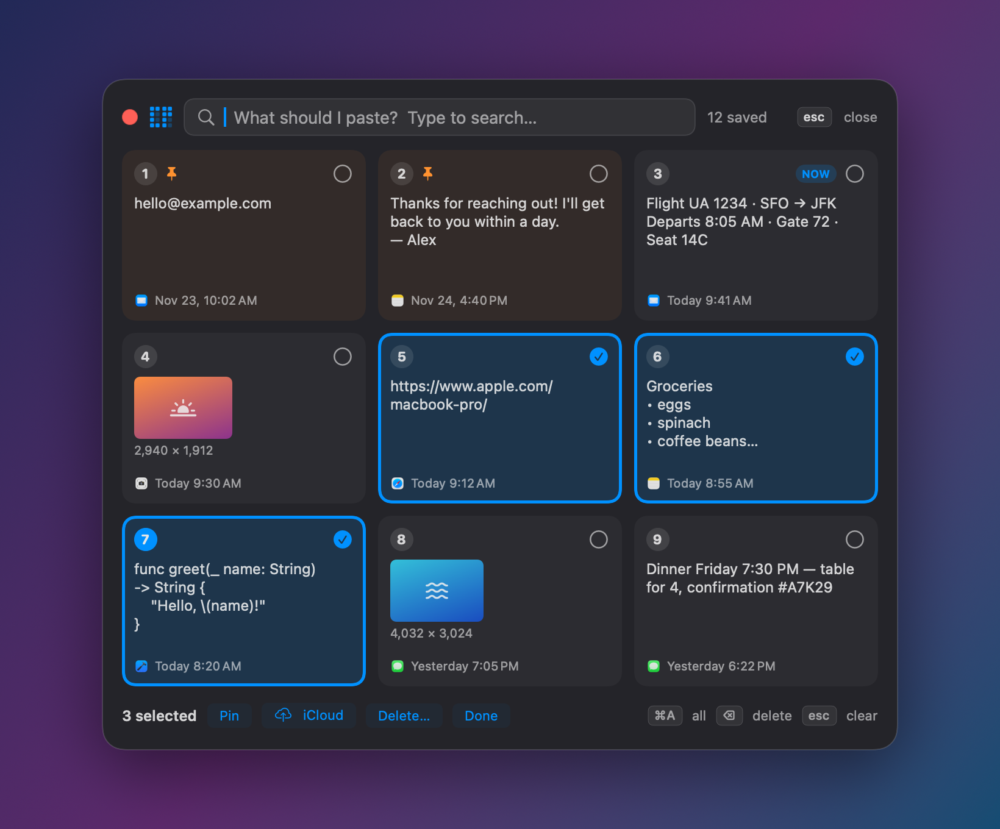
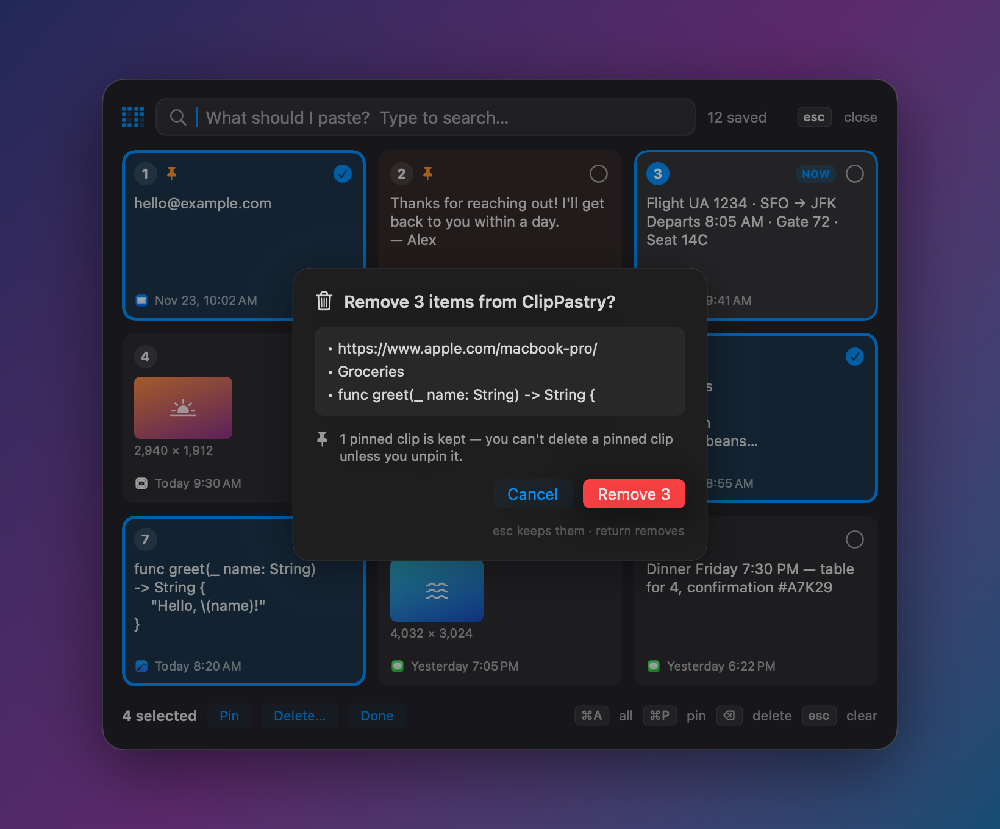
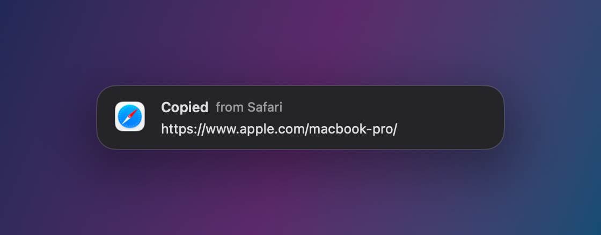
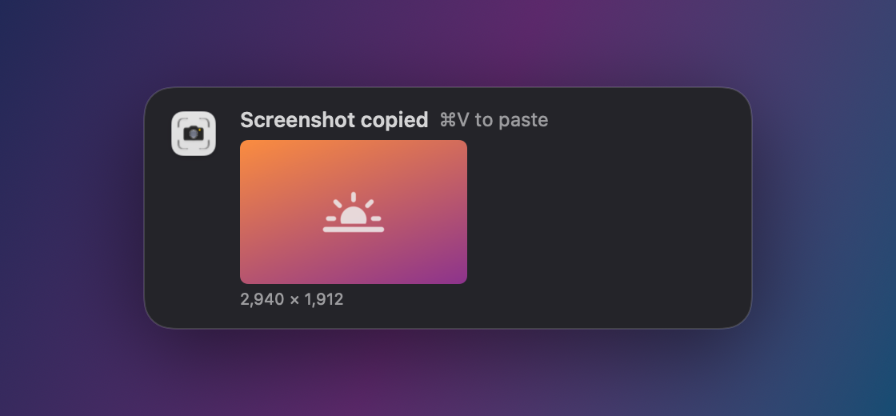

  

<h1 align="center">ClipPastry</h1>

  <b>See your clipboard. Choose what to paste.</b> 
  A small, free app for macOS 14 Sonoma or later. Runs on Apple-silicon and Intel Macs. 
  by Manish Arora

  <a href="https://github.com/mannyarora/clippastry-releases/releases/latest/download/ClipPastry.dmg"><b>⬇︎ Download ClipPastry for Mac</b></a> (ClipPastry.dmg, 2 MB)
   <a href="docs/ClipPastry-Guide.pdf">📄 Guide (PDF)</a> &nbsp;·&nbsp; <a href="https://github.com/mannyarora/clippastry-releases/releases">📝 Release notes</a>
  &nbsp;·&nbsp; <a href="https://mannyaiguide.vercel.app/clippastry.html">🌐 ClipPastry on Manny's AI Guide</a>

  

Every time you copy something, ClipPastry keeps a copy. When you press **⌘V**, it asks **"What should I paste?"** and shows your recent copies in a **3×3 grid**: text, links, images, screenshots and files. Each tile shows where the item came from and when you copied it. Press a number or click a tile and it's pasted.

---

## Features

### ⌘V asks what to paste
- Your **last 99 copies**, 9 at a time in a 3×3 grid. **Scroll** for older ones. You can set how many to keep (9–99) with a slider in the menu.
- Press **1–9** to paste a tile instantly, or press **⌘V twice** to paste your latest copy as usual.
- Use the **arrow keys + Return**, or just **click** a tile.
- Each tile shows a **preview** (text, image thumbnail with its size, or file), the **app** it came from, and the **date and time** you copied it, such as *Today 9:41 AM*, *Yesterday 7:05 PM* or *Nov 23, 10:02 AM*.
- **NOW** marks what's on your clipboard right now.

### Search: just type
The search bar is always at the top of the grid. Start typing to filter your whole history by text, app name or date (try "today" or "nov 23"). Return pastes the highlighted match, and Esc clears the search.

### Pin your favorites
Press **⌘P** or click the pin icon on a tile to pin something you paste often, like your email address, home address or a standard reply.
- Pinned clips sit **first in the grid**, so they're always on the same number keys.
- They **never age out** and **survive Clear History**.
- **⌘V ⌘V still pastes your latest copy**, not a pin.
- They're also under **Pinned ▸** in the menu bar menu.

### Pinned clips are protected
You can't delete a pinned clip unless you unpin it. If you try, ClipPastry tells you and offers an **Unpin** button.

### Delete one clip, or many at once
- **One:** hover over a tile and click ✕, or press **⌫**.
- **Many:** **⌘-click** tiles, **Shift-click** for a range, or **⌘A** for all. Then press **⌫** or click **Delete…**.
- ClipPastry **always asks first**, and **Esc** keeps everything. If your selection includes pinned clips, only the unpinned ones are removed.

### Paste as plain text
Hold **⌥ Option** while choosing (⌥1–⌥9, ⌥Return or ⌥-click) to paste without fonts, colors or links. That's useful when copying from a web page into an email or document.

### A popup for every copy
A small, quiet popup shows what you just copied and which app it came from. You can turn it off, or move it to the top or bottom of the screen.

### Screenshots go straight to ClipPastry
Take a screenshot (⌘⇧3, ⌘⇧4 or ⌘⇧5) and ClipPastry copies it right away, so **⌘V ⌘V pastes it**. The file is still saved where your screenshots normally go.

### Lives in your menu bar
Click the ClipPastry icon (a little grid that spells **C P**) for:
- your **last 3 copies**,
- your **Pinned** clips,
- **See More…** to open the full grid,
- the settings.

There's no Dock icon and nothing to manage. It starts by itself when you log in.

### Works with your other apps
Dictation apps like **Wispr Flow**, text expanders and password managers paste by sending their own ⌘V. ClipPastry recognizes that and lets them paste normally, so only a ⌘V *you* press opens the grid. Copies that password managers mark as secret are **never saved or shown**.

### Updates itself
ClipPastry checks for new versions once a day and offers to install them. You can also click **Check for Updates…** in its menu.

---

## Keyboard shortcuts

| In the grid | What it does |
|---|---|
| **1–9** | Paste that tile (while the search box is empty) |
| **⌘V** (again) or **Return** | Paste the highlighted tile (your latest copy by default) |
| **⌥** + any of the above | Paste as plain text |
| *type anything* | Search |
| **← ↑ ↓ →** | Move around the grid |
| **⌘P** | Pin / unpin |
| **⌘-click**, **Shift-click**, **⌘A** | Select several |
| **⌫** | Remove (asks first) |
| **Esc** | Clear the search, clear the selection, or close |
| **⌃⌘V** (anywhere) | Open the grid any time |

---

## Install

1. **[Download ClipPastry.dmg](https://github.com/mannyarora/clippastry-releases/releases/latest/download/ClipPastry.dmg)**. It always gets the newest version.
2. Open it and **drag ClipPastry into Applications**.
3. Open ClipPastry from Applications. Its icon appears in the menu bar at the top right of your screen.
4. When macOS asks, allow ClipPastry in **System Settings → Privacy & Security → Accessibility**. On newer macOS this list is called **Device Control and Data Access**. This permission is what lets ClipPastry show the grid when you press ⌘V and paste your choice.
5. macOS may also ask to let ClipPastry see the folder your screenshots are saved to (Desktop or Downloads). Allow it if you want screenshots in ClipPastry.

ClipPastry is signed and **notarized by Apple**, so it opens without any "unidentified developer" warning.

**Requirements:** macOS 14 Sonoma or later, on an Apple-silicon or Intel Mac.

---

## Privacy

- **Everything stays on your Mac.** Your clipboard history is saved only in `~/Library/Application Support/ClipPastry`, which only your user account can read. It's **excluded from Time Machine backups**.
- **Passwords are never saved.** Copies that password managers mark as secret are skipped entirely.
- **No accounts, no tracking, no analytics.** The only time ClipPastry goes online is the daily check for updates on this page.
- **You're in control:** remove clips one at a time or all at once with **Clear History…**. To keep history only until you quit, untick **Keep History After Restart**.

---

## Settings (in the menu bar menu)

| Setting | Default |
|---|---|
| Remember last … copies | 99 (slider 9–99) |
| Keep History After Restart | On |
| Ask What to Paste on ⌘V | On |
| Copy New Screenshots | On |
| Show Screenshot Thumbnail (macOS's corner preview) | Same as your Mac's setting (⌘⇧5 → Options) |
| Show Popup When Copying / Popup Position | On / Bottom |
| Show Clipboard in Menu Bar | Off (icon only) |
| Open at Login | On |

---

## FAQ

**Wasn't this called ClipPeek?**
Yes. ClipPeek was renamed ClipPastry in version 1.0.2. Nothing else changed: if you have ClipPeek, it updates itself, renames itself to ClipPastry, and keeps your history, pins, settings and permissions.

**Sometimes ⌘V just pastes without the grid. Why?**
When a password box is selected, in any app or browser, macOS turns on *secure input* and hides key presses from every app, ClipPastry included. Click out of the password box and the grid comes back.

**Does Edit → Paste open the grid?**
No, only the ⌘V shortcut does. Clicking Paste in a menu pastes as usual.

**Can I use it with my iPhone?**
Apple's Universal Clipboard already works with ClipPastry. Pick any old item in ClipPastry on your Mac, and you can paste it on your iPhone within a couple of minutes. Things you copy on your iPhone usually show up in ClipPastry too.

**How do I uninstall it?**
Quit ClipPastry from its menu, then drag it from Applications to the Trash. To also remove your saved history, delete `~/Library/Application Support/ClipPastry`.

---

## License

**ClipPastry © 2026 Manish Arora. All rights reserved.**

- **Personal use:** free.
- **Commercial use** (at a business, school or other organization): **requires a commercial license**. For licensing, email **aroramanish70@gmail.com**.
- Please don't sell, modify or redistribute ClipPastry. Share this page instead.

Full terms are in [LICENSE.md](LICENSE.md). ClipPastry includes [Sparkle](https://sparkle-project.org) for updates; see [THIRD-PARTY-NOTICES.md](THIRD-PARTY-NOTICES.md).

ClipPastry © 2026 Manish Arora · <a href="mailto:aroramanish70@gmail.com">aroramanish70@gmail.com</a>

