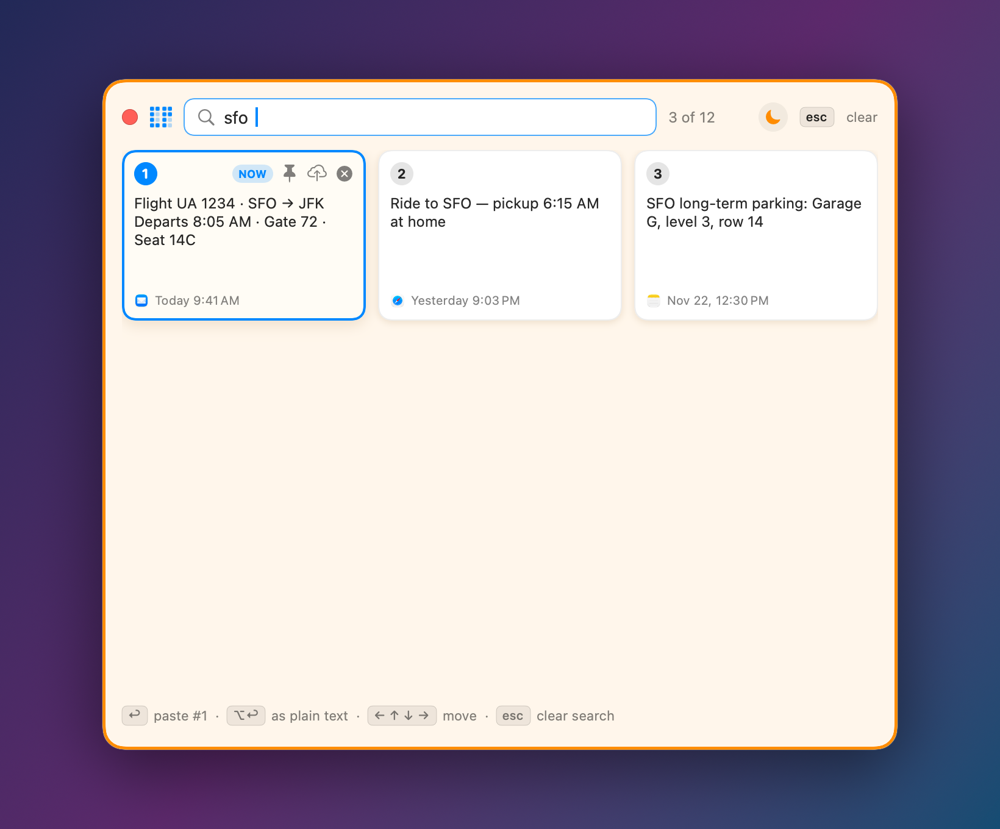
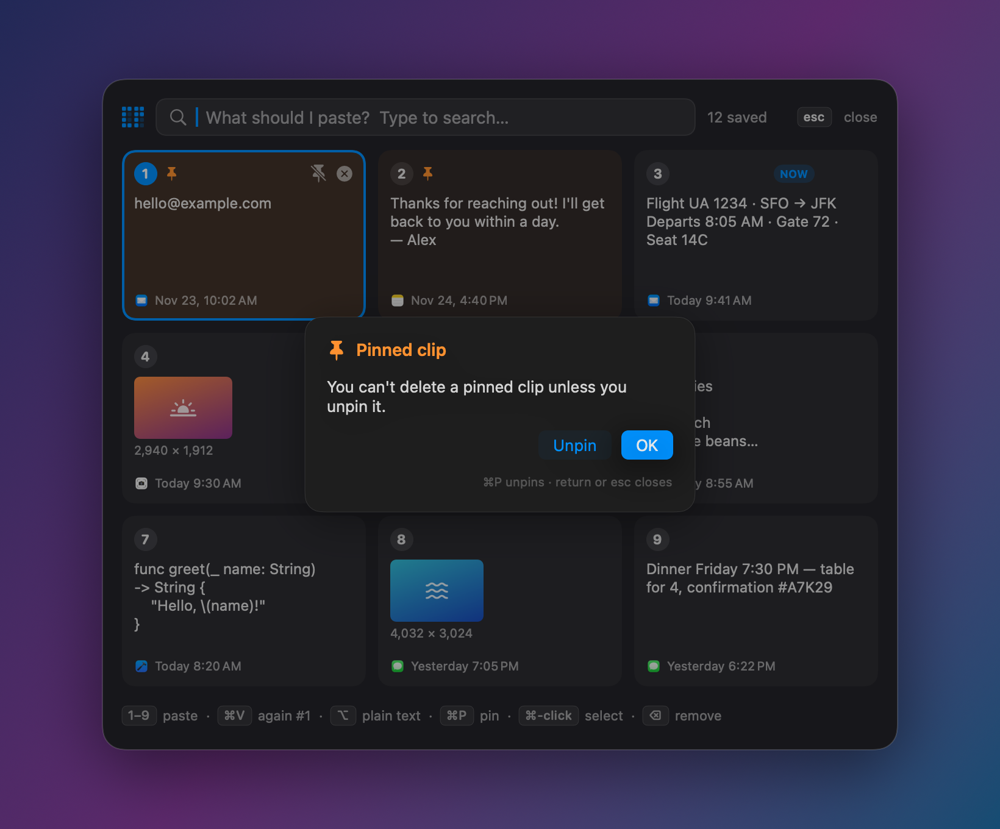
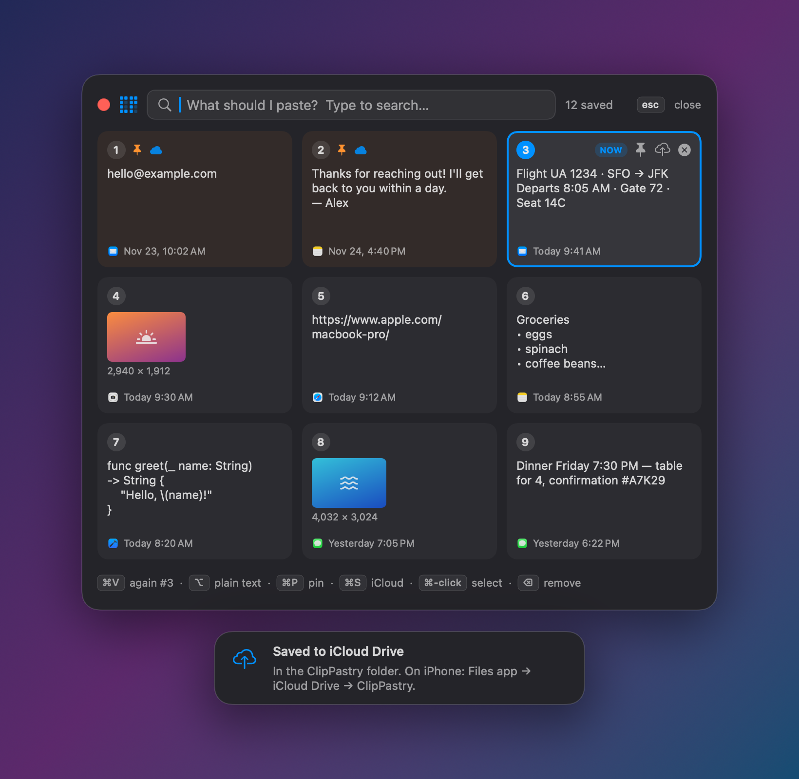
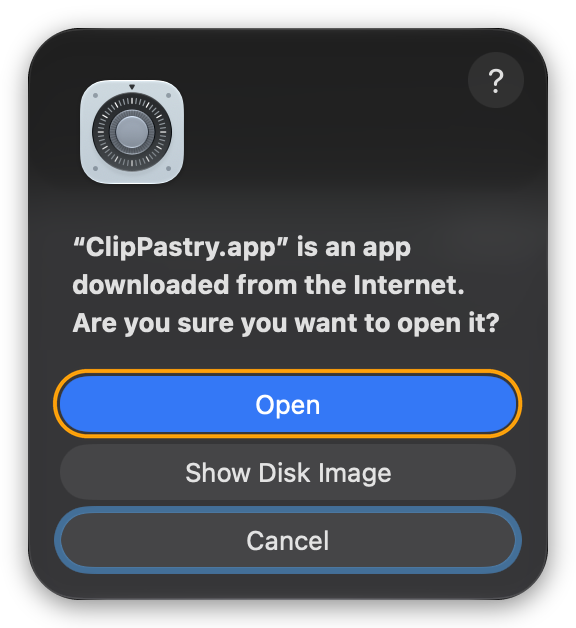
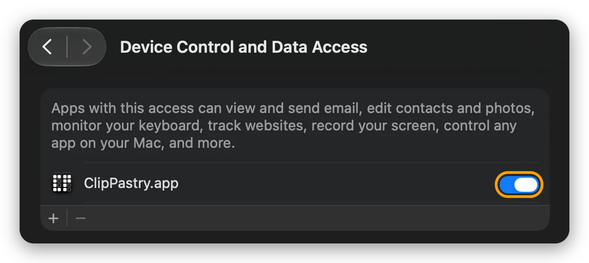

  

<h1 align="center">ClipPastry</h1>

  <b>See your clipboard. Choose what to paste.</b> 
  A small, free app for macOS 14 Sonoma or later. Runs on Apple-silicon and Intel Macs. 
  by Manish Arora

  <a href="https://github.com/mannyarora/clippastry-releases/releases/latest/download/ClipPastry.dmg"><b>⬇︎ Download ClipPastry for Mac</b></a> (ClipPastry.dmg, 2 MB)
   <a href="docs/ClipPastry-Guide.pdf">📄 Guide (PDF)</a> &nbsp;·&nbsp; <a href="https://github.com/mannyarora/clippastry-releases/releases">📝 Release notes</a>
  &nbsp;·&nbsp; <a href="https://clippastry.com">🌐 clippastry.com</a>

  

Every time you copy something, ClipPastry keeps a copy. When you press **⌘V**, it asks **"What should I paste?"** and shows your recent copies in a **3×3 grid**: text, links, images, screenshots and files. Each tile shows where the item came from and when you copied it. Press a number or click a tile and it's pasted. Need a clip on your iPhone? Click **☁︎** and it's in iCloud Drive.

---

## Features

### ⌘V asks what to paste
- Your **last 99 copies**, 9 at a time in a 3×3 grid (resize it to see more). **Scroll** for older ones. You can set how many to keep (9–99) with a slider in the menu.
- **Click** a tile to paste it, or use the **arrow keys + Return**. Press **⌘V twice** to paste your latest copy as usual.
- Each tile shows a **preview** (text, image thumbnail with its size, or file), the **app** it came from, and the **date and time** you copied it, such as *Today 9:41 AM*, *Yesterday 7:05 PM* or *Nov 23, 10:02 AM*.
- **NOW** marks what's on your clipboard right now.
- The grid opens in the **bottom right corner**. Drag its top bar to **move** it, or drag its edges to **resize** it (3–6 tiles across, 2–6 rows). It remembers both.
- **Light or dark:** click the moon/sun in the grid's top bar. The orange border keeps it from blending into the page behind it.

### Search: just type
The search bar is always at the top of the grid. Start typing to filter your whole history by text, app name or date (try "today" or "nov 23"). Return pastes the highlighted match, and Esc clears the search.

### Pin your favorites
Press **⌘P** or click the pin icon on a tile to pin something you paste often, like your email address, home address or a standard reply.
- Pinned clips sit **first in the grid**.
- They **never age out** and **survive Clear History**.
- **⌘V ⌘V still pastes your latest copy**, not a pin.
- They're also under **Pinned ▸** in the menu bar menu.

### Pinned clips are protected
You can't delete a pinned clip unless you unpin it. If you try, ClipPastry tells you and offers an **Unpin** button.

### Paste or delete several clips at once
- **Select:** **⌘-click** tiles, **Shift-click** for a range, or **⌘A** for all.
- **Paste them:** press **Return** or click **Paste**, and they're pasted one after another in the order you picked them, pictures too. **⇧Return** or **Together** joins the text into one paste, each clip on its own line.
- **Delete them:** press **⌫** or click **Delete…** (for one clip, hover over its tile and click ✕).
- ClipPastry **always asks first**, and **Esc** keeps everything. If your selection includes pinned clips, only the unpinned ones are removed.

### Paste as plain text
Hold **⌥ Option** while choosing (⌥Return or ⌥-click) to paste without fonts, colors or links. That's useful when copying from a web page into an email or document.

### A popup for every copy
A small, quiet popup shows what you just copied and which app it came from. You can turn it off, or move it to the top or bottom of the screen.

### Screenshots go straight to ClipPastry
Take a screenshot (⌘⇧3, ⌘⇧4 or ⌘⇧5) and ClipPastry copies it right away, so **⌘V ⌘V pastes it**. The file is still saved where your screenshots normally go.

### Send clips to your iPhone
Need a boarding pass, an address, a link or a screenshot on your phone? Click **☁︎** on any clip, or press **⌘S**, and ClipPastry saves it to **iCloud Drive › ClipPastry**. A moment later it's on your iPhone, iPad and your other Macs. To send several, ⌘-click them and click **iCloud**. A small ☁︎ on a tile means it's already saved.

- Text is saved as a text file, pictures and screenshots at full size, and files as copies.
- Only the clips you pick are uploaded, to your own iCloud account. Nothing goes up on its own.

**Open them on your iPhone.** They're files in iCloud Drive, not in the iPhone keyboard.
1. Open the **Files** app on your iPhone.
2. Tap **Browse** at the bottom, then **iCloud Drive**, then the **ClipPastry** folder.
3. Tap a file to open it, then touch and hold the text → **Select All** → **Copy**, and paste wherever you like. For a picture, tap the share button → **Copy**, or **Save Image** to put it in Photos.

> **Tip:** touch and hold the ClipPastry folder → **Favorite** to reach it in one tap. If the folder isn't there yet, pull down to refresh, and check that iCloud Drive is on: **Settings → your name → iCloud → iCloud Drive**.

### Lives in your menu bar
Click the ClipPastry icon (a little grid that spells **C P**) for:
- your **last 3 copies**,
- your **Pinned** clips,
- **See More…** to open the full grid,
- **Open iCloud Drive Folder** to see the clips you've sent to iCloud,
- the settings.

There's no Dock icon and nothing to manage. It starts by itself when you log in.

### Works with your other apps
Dictation apps like **Wispr Flow**, text expanders and password managers paste by sending their own ⌘V. ClipPastry recognizes that and lets them paste normally, so only a ⌘V *you* press opens the grid. Copies that password managers mark as secret are **never kept in your history**.

### Updates itself
ClipPastry checks for new versions once a day and offers to install them. You can also click **Check for Updates…** in its menu.

---

## Keyboard shortcuts

| In the grid | What it does |
|---|---|
| **⌘V** (again) or **Return** | Paste the highlighted tile (your latest copy by default) |
| **⌘1** … **⌘9** | Paste tile 1 to 9 |
| **⌥** + any of the above | Paste as plain text |
| *type anything* | Search (numbers too) |
| **← ↑ ↓ →** | Move around the grid |
| **⌘P** | Pin / unpin |
| **⌘S** | Save to iCloud Drive (the highlighted clip, or all selected) |
| **⌘-click**, **Shift-click**, **⌘A** | Select several |
| **Return** / **⇧Return** with several selected | Paste them one after another / together |
| **⌫** | Remove (asks first) |
| **Esc** | Clear the search, clear the selection, or close |
| **Red dot** (top left) | Close the grid |
| **⌃⌘V** (anywhere) | Open the grid any time |

---

## Install

1. **[Download ClipPastry.dmg](https://github.com/mannyarora/clippastry-releases/releases/latest/download/ClipPastry.dmg)**. It always gets the newest version.
2. Open it and **drag ClipPastry into Applications**. If you already have it, click **Replace** when asked.
3. Open ClipPastry from Applications. macOS asks if you're sure you want to open an app downloaded from the internet: click **Open**. Its icon then appears in the menu bar at the top right of your screen. 
   
4. **Switch ClipPastry on. This step is required.** ClipPastry's welcome guide opens with a button that takes you straight there (or, when macOS asks, click **Open System Settings**). Turn on the switch next to **ClipPastry** under **Privacy & Security → Accessibility** (on the newest macOS this list is called **Device Control and Data Access**). Without it, ⌘V pastes as usual and the grid never opens. When it's on, ClipPastry shows *“Paste picker is on.”* 
    
   If it already looks on but ⌘V doesn't show the grid, see [⌘V never shows the grid](#faq).
5. macOS may also ask to let ClipPastry see the folder your screenshots are saved to (Desktop or Downloads). Allow it if you want screenshots in ClipPastry.

ClipPastry is signed and **notarized by Apple**, so it opens without any "unidentified developer" warning.

**Requirements:** macOS 14 Sonoma or later, on an Apple-silicon or Intel Mac.

---

## Privacy

- **Everything stays on your Mac**, except clips you choose to send to iCloud Drive. Your clipboard history is saved only in `~/Library/Application Support/ClipPastry`, which only your user account can read. It's **excluded from Time Machine backups**.
- **Passwords stay out of your history.** Copies that password managers mark as secret are never saved in ClipPastry's history. You can still send one to iCloud Drive yourself with ☁︎ while it's on your clipboard.
- **iCloud only when you ask.** Clips you save with ☁︎ go to your own iCloud Drive, synced by your Mac's iCloud, and nowhere else.
- **No accounts, no tracking, no analytics.** The only time ClipPastry itself goes online is the daily check for updates on this page.
- **You're in control:** remove clips one at a time or all at once with **Clear History…**. To keep history only until you quit, untick **Keep History After Restart**.

---

## Settings (in the menu bar menu)

| Setting | Default |
|---|---|
| Remember last … copies | 99 (slider 9–99) |
| Keep History After Restart | On |
| Ask What to Paste on ⌘V | On |
| Paste Grid: Light / Dark Background, Reset Size and Position | Light, 3×3 in the bottom right |
| Copy New Screenshots | On |
| Show Screenshot Thumbnail (macOS's corner preview) | Same as your Mac's setting (⌘⇧5 → Options) |
| Show Popup When Copying / Popup Position | On / Bottom |
| Show Clipboard in Menu Bar | Off (icon only) |
| Open at Login | On |

---

## FAQ

**Sometimes ⌘V just pastes without the grid. Why?**
When a password box is selected, in any app or browser, macOS turns on *secure input* and hides key presses from every app, ClipPastry included. Click out of the password box and the grid comes back.

**⌘V never shows the grid.**
ClipPastry doesn't have the Accessibility permission. Click its menu bar icon → **Needs Accessibility access…** and switch ClipPastry on. If it already looks on, macOS is holding an old permission from an earlier copy: select ClipPastry in that list, click **−** to remove it, then click **Needs Accessibility access…** again and switch it on. (⌃⌘V opens the grid even without the permission.)

**Does Edit → Paste open the grid?**
No, only the ⌘V shortcut does. Clicking Paste in a menu pastes as usual.

**Can I use it with my iPhone?**
Yes, two ways. **Save to iCloud Drive:** click ☁︎ on a clip and open it in the **Files** app on your iPhone (see [Send clips to your iPhone](#send-clips-to-your-iphone)). It stays there until you delete it. **Universal Clipboard:** pick any item in ClipPastry on your Mac and you can paste it on your iPhone within a couple of minutes. Things you copy on your iPhone usually show up in ClipPastry too.

**How do I uninstall it?**
Quit ClipPastry from its menu, then drag it from Applications to the Trash. To also remove your saved history, delete `~/Library/Application Support/ClipPastry`.

---

## License

**ClipPastry © 2026 Manish Arora. All rights reserved.**

- **Free for everyone:** personal and commercial use, at home or at a business, school or other organization. No license request needed.
- Please don't sell, modify or redistribute ClipPastry. Share this page instead.

Full terms are in [LICENSE.md](LICENSE.md). ClipPastry includes [Sparkle](https://sparkle-project.org) for updates; see [THIRD-PARTY-NOTICES.md](THIRD-PARTY-NOTICES.md).

ClipPastry © 2026 Manish Arora · <a href="mailto:aroramanish70@gmail.com">aroramanish70@gmail.com</a>

